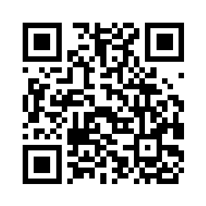

# Поддержать проект

USDT (TRC20): `TGi6i9DgBHQV6RNzVSMQmgamGrYh5RdZYH`

Только сеть TRON (TRC20); перевод через другую сеть пропадёт.

---

# Support the project

USDT (TRC20): `TGi6i9DgBHQV6RNzVSMQmgamGrYh5RdZYH`

TRON (TRC20) only; a transfer over another network is lost.
